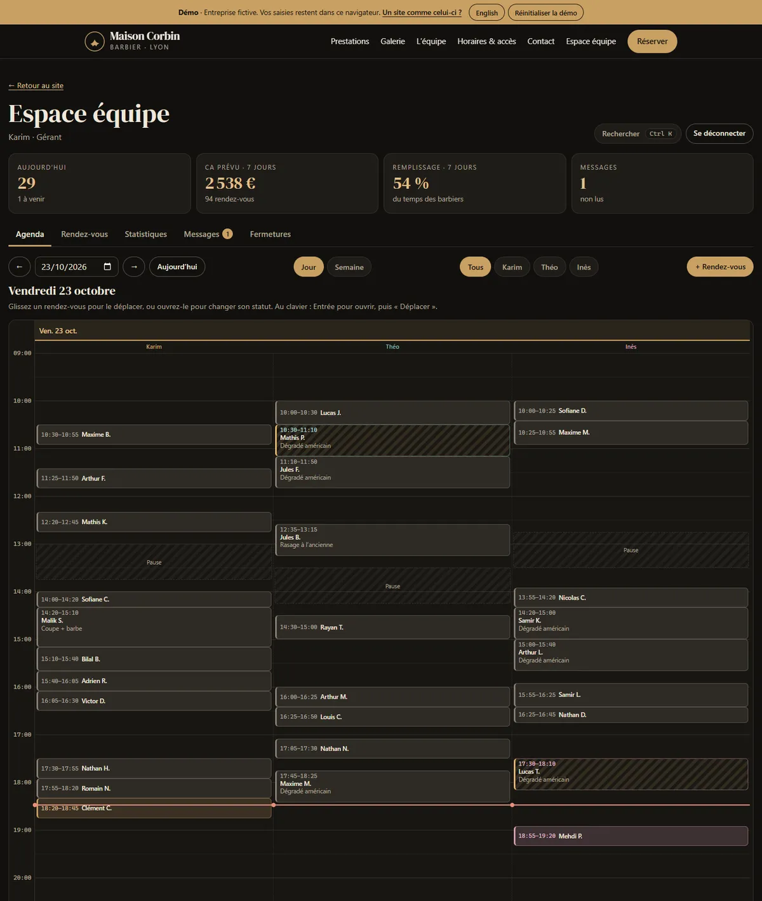
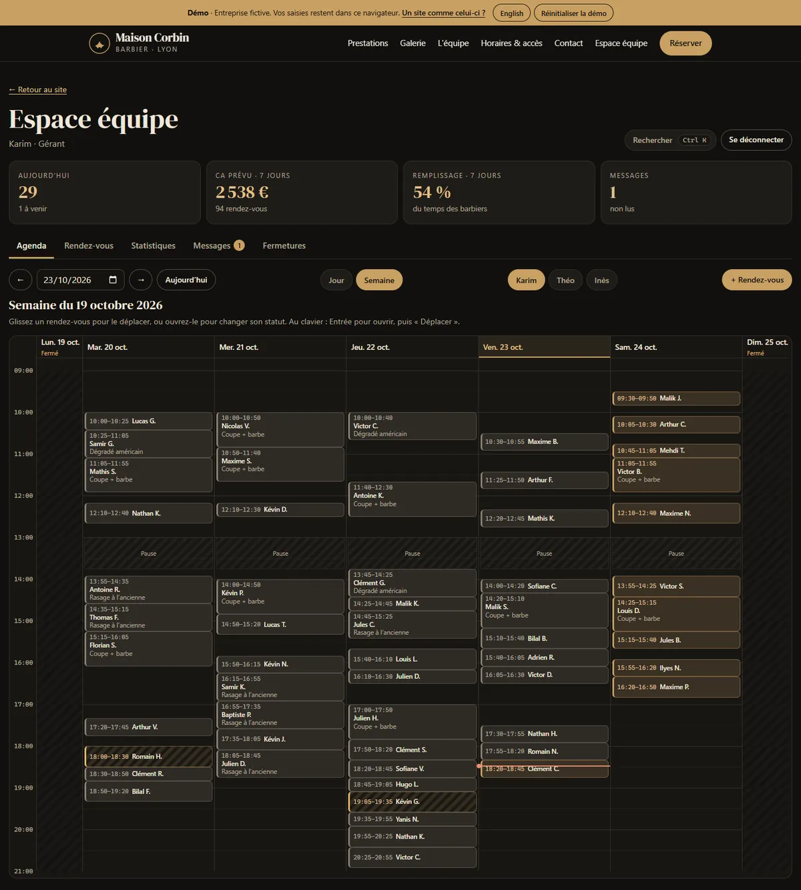
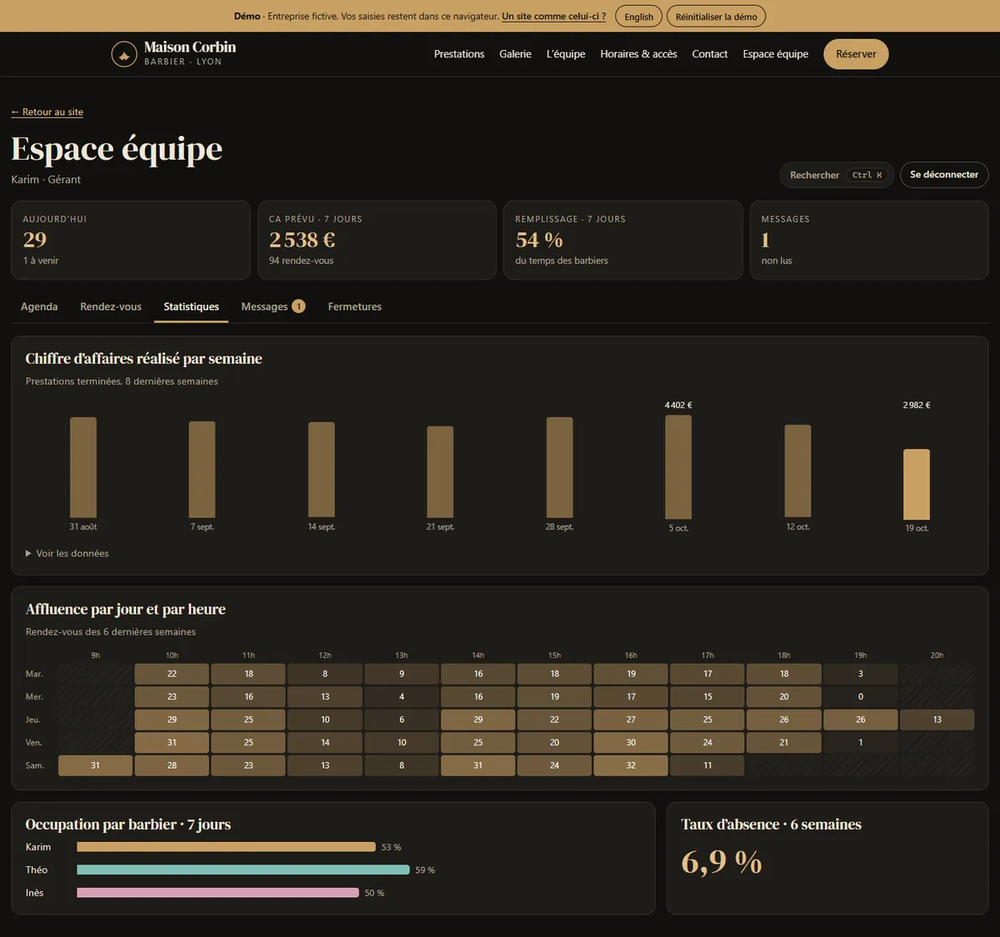
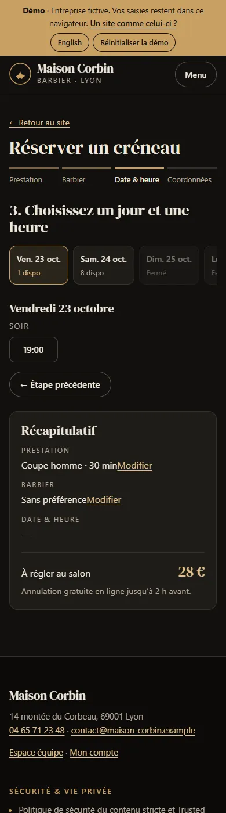
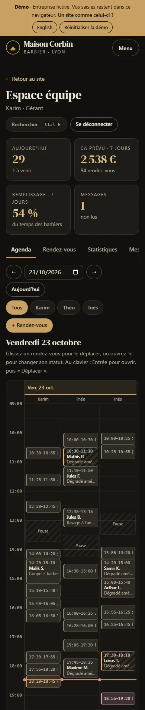
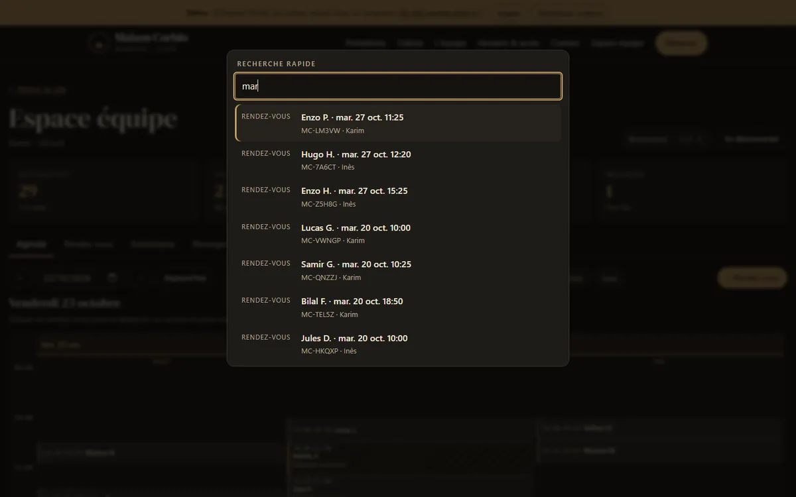
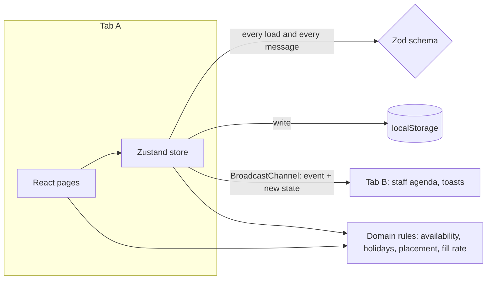

# Maison Corbin · barber shop booking (demo)

[](https://github.com/Barkatzineddine/demo-barbier/actions/workflows/ci.yml)
[](https://barkatzineddine.github.io/demo-barbier/)

[](LICENSE)

A fictional barber shop in Lyon: a showcase site with online booking and customer accounts, plus a staff area where the team runs its agenda with drag and drop, sees new bookings arrive live, and reads the shop's numbers. French interface with an English switch, installable, works offline.

**Live: <https://barkatzineddine.github.io/demo-barbier/>** (the staff page lists two demo accounts: a manager and a barber).



## Try it in two minutes

1. **Book** a slot: service, barber (or no preference), day and time, details. You get a booking code and an `.ics` file for your calendar.
2. Open the **staff area** in a second tab and sign in with the manager demo account. Book again in the first tab: the staff tab shows a notification and the new booking straight away.
3. **Drag** a booking to another barber or time. Invalid drops (a break, a conflict, the past) are refused, and every move can be undone. The customer's tab is told that their appointment moved.
4. Press **Ctrl K** and search a booking by name, code or phone number.
5. Switch to **English**, install the app, then go offline: it keeps working.

## Features

**Customers**
- Service list, gallery with a keyboard and swipe lightbox, team, opening hours with a live "open now" status, contact form.
- Four-step booking driven by a real availability engine: opening hours, each barber's days and break, 15-minute grid, 30 minutes notice, four weeks ahead, French public holidays (Easter-based ones computed), closures set by the manager.
- Optional account (PBKDF2-hashed password) to find bookings on any visit; bookings made without an account stay listed on the device. Self-service cancellation up to two hours before.

**Staff**
- Agenda in day view (all barbers side by side) or week view (one barber), with drag and drop, a live drop indicator, an undo, a "now" line, and a dialog that does the same moves from the keyboard.
- Roles: the manager sees every barber, the messages and the closures; a barber sees their own agenda and figures.
- Bookings list with instant search, filters and a CSV export; statistics (revenue per week, busy hours heatmap, occupancy per barber, no-show rate); phone bookings; closures with a warning when bookings exist that day.
- Live updates between tabs: new and cancelled bookings, moved appointments, new messages.

| Week view | Statistics |
| --- | --- |
|  |  |

| Booking on mobile | Agenda on mobile | Command palette |
| --- | --- | --- |
|  |  |  |

## Engineering

**Stack:** React 19, TypeScript 6 in strict mode (with `noUncheckedIndexedAccess`), Vite 8, Zustand for state, Zod (`zod/mini`) for validation, dnd-kit for drag and drop. No UI kit and no router library: a small typed hash router (about 70 lines) fits GitHub Pages. Every dependency is pinned to an exact version.



- **One set of rules.** Availability, holidays and the `checkPlacement` guard are pure functions in `src/domain`. The booking form, the staff drag and drop, the "move" dialog and the demo data generator all go through them, so they can't disagree, and they are tested once.
- **The state is never trusted.** Whatever comes from `localStorage` or from another tab is parsed with the same Zod schema; invalid or hand-edited data falls back to fresh demo data instead of being rendered.
- **Cross-tab sync without a race.** The first version re-read `localStorage` on each BroadcastChannel message. The browser tests showed that Chrome can deliver the message before the other tab's storage write is visible, so the message now carries the validated new state.
- **Light on the network.** The booking, account and staff screens are separate chunks loaded on demand; a small service worker generated at build time precaches the app shell for offline use.

```
src/
  domain/   pure business rules (dates, holidays, slots, seed data, iCalendar)
  state/    the persisted store, bookings, accounts, sessions
  shared/   router, i18n, security helpers, anti-spam guard, UI primitives
  pages/    Home, Booking, Account, staff/ (Agenda, BookingsList, Stats, Messages, Closures)
  i18n/     French and English dictionaries (same keys, checked by a test)
build/      Vite plugins: CSP meta tag, service worker
tests/      unit/ (Vitest) and e2e/ (Playwright)
```

## Quality gates

Every push runs the [CI workflow](.github/workflows/ci.yml). The site is deployed to GitHub Pages only when all of it passes.

| Gate | What it checks |
| --- | --- |
| Lint | `typescript-eslint` strict, React hooks rules, and a ban on `innerHTML`, `outerHTML` and `dangerouslySetInnerHTML` |
| Types | `tsc` in strict mode, no `any` escape hatches |
| Unit tests | 97 Vitest tests: availability engine, holidays, passwords, CSV, anti-spam, store and cross-tab messages, accounts and login throttling, translations, command palette. Coverage threshold on the logic (94.6 % of lines) |
| Browser tests | 23 Playwright scenarios on a desktop and a mobile profile: booking, drag and drop with undo, live sync between two tabs, roles, offline mode, language switch, axe accessibility scans (WCAG 2.2 AA) of every screen, security checks. Any console error fails the test |
| Lighthouse | Lighthouse CI budgets: performance ≥ 90, accessibility 100, best practices 100, SEO ≥ 90 |
| Supply chain | `npm audit`, `npm ci --ignore-scripts`, Actions pinned by commit SHA, Dependabot with a 7-day cooldown |

Lighthouse on the production build (23 October 2026): mobile **97 / 100 / 100 / 100**, desktop **100 / 100 / 100 / 100**.

## Security

- **Strict Content Security Policy** (`default-src 'none'`, scripts and styles from the site only) with **Trusted Types** enforced: the browser itself refuses any HTML string injection. A browser test proves it. The only Trusted Types policy accepts a single URL, the service worker's.
- **No third party:** no CDN, analytics, cookies or trackers. Fonts and photos are served by the site.
- **Input hygiene:** Unicode normalisation, removal of control, zero-width and bidi-override characters (used to spoof text), length limits, checks on names, French phone numbers and e-mail addresses. React escapes all output; a test stores an HTML payload as a customer name and checks it is shown as text.
- **Passwords:** PBKDF2-SHA256 with 100,000 iterations and a random salt (WebCrypto), constant-time comparison, the same answer for an unknown e-mail and a wrong password, a 30-second lock after five failures. Only the session's kind and id are kept, in `sessionStorage`.
- **Anti-spam without a captcha:** honeypot field (bots get a fake success), minimum time to fill a form, per-device rate limit, link limit.
- **Abuse limits:** two upcoming online bookings per phone number; the slot is re-checked at the last moment in case another tab took it.
- **CSV export:** cells starting with `=`, `+`, `-`, `@` are neutralised (spreadsheet formula injection).

**Limits, stated plainly:** this is a front-end demo, so data lives in the browser and the demo accounts are public. In production, accounts, bookings and rate limits would live on a server, sessions would use `HttpOnly` cookies, and the CSP would be sent as an HTTP header (a `<meta>` tag cannot set `frame-ancestors` or reporting).

## Run it locally

Requires Node.js 24.

```bash
npm ci
npm run dev
```

```bash
npm test               # unit tests
npm run test:e2e       # builds, serves and runs the browser tests (uses the installed Chrome locally)
npm run build          # production build in dist/
```

## Credits and license

- Code: [MIT](LICENSE), © 2026 Mohamed Zineddine Barkat.
- Photos: Mostafa Meraji, public domain (CC0), via [Wikimedia Commons](https://commons.wikimedia.org/). Font: DM Serif Display, SIL Open Font License, self-hosted.
- The business, address, team and bookings are fictional. Phone numbers come from the blocks ARCEP reserves for fiction (04 65 71 and 06 39 98); e-mail addresses use the reserved `.example` and `example.com` domains.
