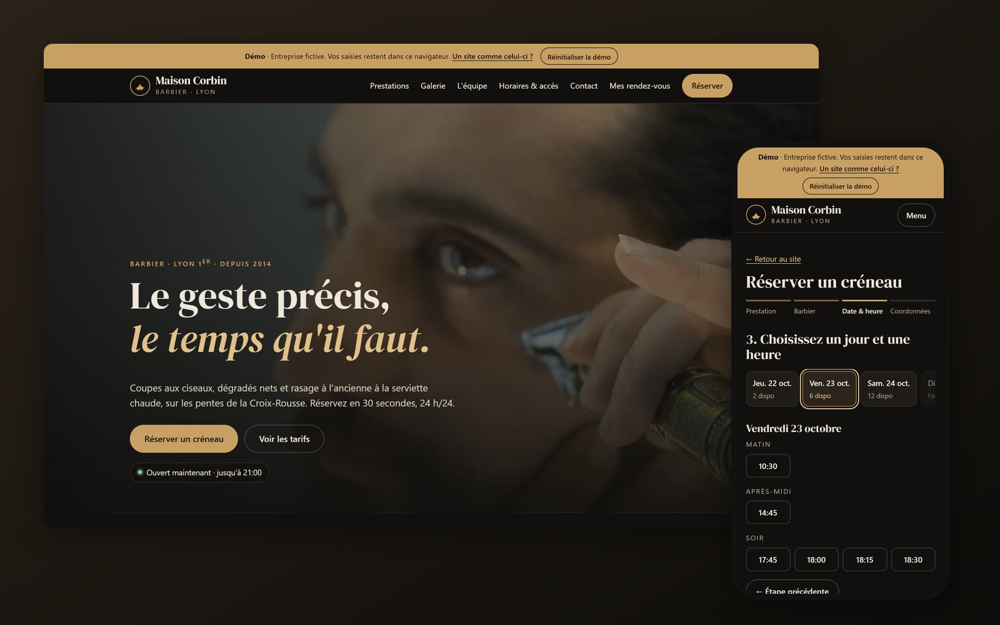
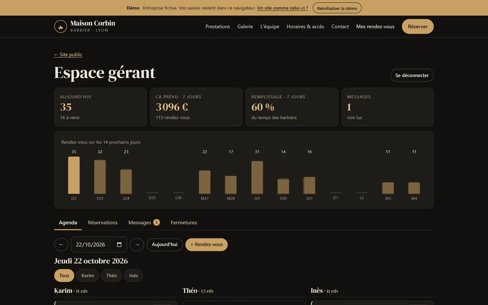

# Maison Corbin · barber shop website with online booking (demo)



**Live demo: https://barkatzineddine.github.io/demo-barbier/** (made for phones first)

A complete showcase website for a fictional barber shop in Lyon, with online booking and an owner area. It is a portfolio piece by [Mohamed Zineddine Barkat](https://barkatzineddine.github.io/) showing what a small business gets: a site that is fast, looks good, and is secure by default. The interface is in French; everything runs in the browser, so you can test the whole flow without an account.

## Try it

| What | Where |
|---|---|
| Book an appointment | **Réserver** → service → barber (or "no preference") → day → free slot → your details. You get a booking code and an `.ics` file for your calendar. |
| Cancel | **Mes rendez-vous** lists bookings made on this device (cancellation up to 2 h before). A booking made elsewhere can be found with its code and phone number. |
| Owner area | Footer → **Espace gérant**, demo PIN **2468**. |
| Contact form | Bottom of the home page. Messages land in the owner's inbox. |
| Start over | **Réinitialiser la démo** in the top banner restores the starting data. |

Tip: open the owner area in a second tab, then book in the first one. The agenda updates live (the tabs share state through the `storage` event).

## Features

**Showcase site**
- Services and prices, photo gallery with a lightbox (keyboard arrows and swipe), team, opening hours with today highlighted, live "open now / opens Tuesday at 10:00" status.
- Address with a drawn map and links to OpenStreetMap and directions. No embedded third-party map, so no tracking.
- Local SEO: title, description, Open Graph, schema.org `HairSalon` structured data, canonical URL, `robots.txt`.

**Booking engine** (`assets/js/data.js`)
- Opening hours per weekday (late opening on Thursday), each barber's working days and lunch break, service durations on a 15-minute grid, 30 minutes minimum notice, 4 weeks ahead.
- French public holidays computed every year (including Easter Monday, Ascension and Whit Monday) plus exceptional closures set by the owner.
- "No preference" gives each slot to the free barber with the lightest day.
- The slot is checked again at confirmation time: if another tab or the owner took it meanwhile, the customer is sent back to the slot list.
- A realistic agenda is generated around today's date, so the demo always looks like a busy shop.

**Owner area** (`assets/js/owner.js`)
- Figures: bookings today, forecast revenue and fill rate over 7 days, unread messages, bookings per day over the next 14 days.
- Day agenda per barber with bookings, breaks and free gaps. Add a phone booking, mark a booking done, no-show or cancelled.
- Searchable, filterable list with CSV export; contact inbox; exceptional closures with a warning when bookings already exist that day.

| Owner agenda | Booking on a phone |
|---|---|
|  |  |

## Security by default

| Measure | How |
|---|---|
| Strict Content-Security-Policy | `default-src 'none'`; scripts, styles, fonts and images from this site only; `form-action 'none'`, `base-uri 'none'`, `object-src 'none'`. Set in a meta tag because GitHub Pages cannot send headers. |
| Trusted Types | `require-trusted-types-for 'script'` with `trusted-types 'none'`: the browser rejects any HTML string sink. There is no `innerHTML` in the code; every element is built with `createElement` and `textContent` ([`core.js`](assets/js/core.js)). |
| No inline code | No inline script, no inline event handler, no `style` attribute. |
| No third party | No CDN, analytics, cookies or trackers. Fonts and photos are served from the site itself. |
| Clean input | Unicode NFC, control, zero-width and bidi-override characters removed, length limits, checks on name, French phone number and e-mail. |
| Anti-spam without captcha | Honeypot field (bots get a fake success), minimum time to fill the form, per-device rate limit, link limit in messages. |
| Defensive storage | Saved data is checked against a schema on load; corrupt or hand-edited data is discarded instead of being displayed. |
| Abuse limits | 2 upcoming bookings per phone number; booking lookup paused for 60 s after 5 wrong attempts; owner PIN compared as SHA-256 with a 30 s lockout. |
| CSV export | Cells starting with `=`, `+`, `-` or `@` are neutralised (spreadsheet formula injection). |

A production version keeps the same checks on a server and adds real authentication for the owner (hashed passwords, two-factor), SMS and e-mail reminders, HTTP security headers, logs and backups.

## Performance

Lighthouse, mobile profile: **Performance 98, Accessibility 100, Best Practices 100, SEO 100** (desktop: 100 on all four). The cover photo weighs 9 to 33 KB in WebP with `srcset`, the font is preloaded, the booking and owner code is loaded only when needed (`import()`), and nothing shifts while the page loads.

## Stack

- HTML, CSS and vanilla JavaScript (ES modules). No framework, no build step, no runtime dependency.
- Font: DM Serif Display, self-hosted (from `@fontsource/dm-serif-display` 5.3.0, SIL Open Font License).
- Images resized and converted to WebP with `sharp`.
- Hosted on GitHub Pages.

## Run locally

ES modules need a web server (opening the file directly will not work):

```bash
python -m http.server 8000
```

Then open http://localhost:8000/.

## Project structure

```
index.html            page, CSP, static content (indexable)
assets/js/core.js     safe DOM builder, storage, input cleaning, anti-spam, dialogs
assets/js/data.js     services, team, hours, holidays, slot engine, demo data
assets/js/app.js      router, open-now status, gallery, contact form
assets/js/booking.js  booking flow
assets/js/mine.js     "my bookings" and lookup by code
assets/js/owner.js    owner area
assets/css/style.css  styles (mobile first)
```

## Credits and license

- Code: [MIT](LICENSE), © 2026 Mohamed Zineddine Barkat.
- Photos: Mostafa Meraji, public domain (CC0), via [Wikimedia Commons](https://commons.wikimedia.org/).
- The business, address, team and bookings are fictional. Phone numbers come from the blocks ARCEP reserves for fiction (04 65 71 and 06 39 98); e-mail addresses use the reserved `.example` and `example.com` domains.

**Want a site like this for your business?** [Get in touch](https://barkatzineddine.github.io/#contact).
